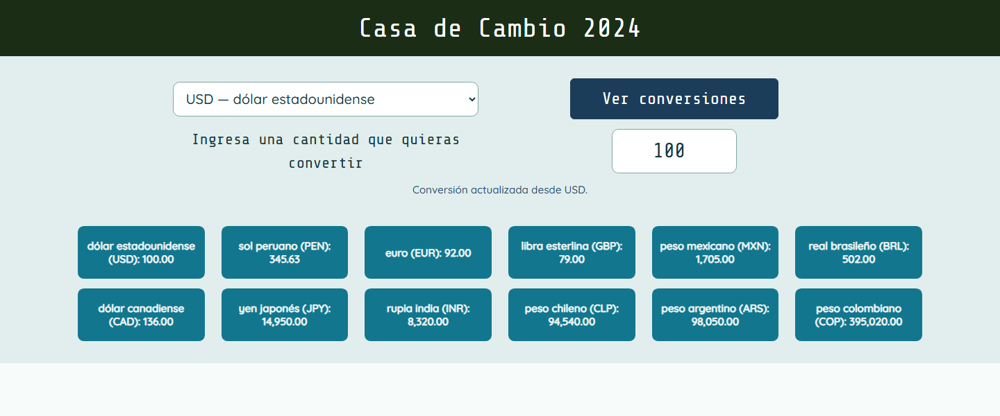

# Casa de Cambio

> Conversor de divisas con jQuery, Bootstrap y una API pública sin clave.

[](https://tejedasebastian.github.io/casa-cambio-boot/)
[](https://github.com/tejedasebastian/casa-cambio-boot/actions/workflows/e2e.yml)



## Qué es

Proyecto de 2024 para practicar jQuery, consumo de APIs y Bootstrap. El usuario elige una moneda de origen, ingresa una cantidad y obtiene la conversión a todas las monedas disponibles.

La versión actual usa [open.er-api.com](https://www.exchangerate-api.com/docs/free), una API pública que **no requiere clave**.

**Demo:** https://tejedasebastian.github.io/casa-cambio-boot/

## Características

- Carga más de 160 monedas al iniciar.
- Conversión desde cualquier moneda a todas las demás.
- Formato de números `es-PE` con dos decimales.
- Estados de carga accesibles (`role="status"`, `aria-live`, `aria-busy`).
- Manejo de errores y timeout si la API no responde.
- Botón bloqueado durante la conversión para evitar dobles envíos.
- Reintento de carga si falla la API inicial.
- Layout responsive probado a 1440, 390 y 320 px.
- Sin build step: HTML, CSS y JS estáticos.

## Stack

| Capa | Herramienta |
|---|---|
| UI | HTML5, CSS3, Bootstrap 5.3 |
| Interacción | jQuery 3.7.1 (CDN con SRI) |
| API | open.er-api.com (ExchangeRate-API, free tier) |
| E2E | Playwright (Chromium) |
| CI | GitHub Actions |
| Lint | ESLint + Standard |
| Deploy | GitHub Pages (rama `gh-pages`) |

## Estructura

```text
.
├── index.html
├── main.css
├── main.js                    # Conversión, estados y validación
├── casadecambio-jquery.js     # Carga de monedas y select
├── dinero.svg / dinero.png
├── docs/preview.png
├── e2e/
│   ├── server.mjs             # Servidor estático para pruebas
│   ├── conversion.spec.mjs    # E2E con API simulada
│   └── live/live.spec.mjs     # Smoke test contra la demo real
├── scripts/capture-preview.mjs
├── playwright.config.mjs
├── playwright.live.config.mjs
├── .github/workflows/e2e.yml
├── package.json
└── .eslintrc.json
```

## Correr en local

No necesita instalación para funcionar: jQuery y Bootstrap vienen de CDN.

```bash
npm install
npm run empezar
```

Abre `http://127.0.0.1:8080`.

## Pruebas E2E

Las pruebas usan `page.route` para simular `open.er-api.com`, así que son deterministas y no dependen de la red. Corren en el puerto **4184**.

```bash
npm run test:e2e
```

Cobertura:

- carga de monedas y conversión USD 100 con filas y estado final;
- cantidad 0 o vacía: error visible y cero requests de conversión;
- respuesta 500: error visible y botón reactivado;
- API lenta: estado “Convirtiendo…”, controles bloqueados y recuperación;
- doble click: una sola conversión;
- fallo inicial: botón de reintento y recuperación;
- móvil 390 y 320 px: sin overflow horizontal, assets cargados y consola limpia.

Reportes generados:

- `playwright-report/index.html`
- `artifacts/results.json`

El workflow [`.github/workflows/e2e.yml`](.github/workflows/e2e.yml) ejecuta las pruebas en cada push a `main` y en pull requests, y publica ambos reportes como artifacts.

### Smoke test contra la demo

Prueba opcional sin mocks, contra GitHub Pages. No forma parte del CI para no depender de la red ni de la API pública.

```bash
npm run test:e2e:live
```

Se puede apuntar a otra URL con `LIVE_URL`.

## Regenerar la vista previa

```bash
npm run docs:preview
```

Genera `docs/preview.png` con datos simulados y un viewport de 1440 px.

## Nota de seguridad

La versión anterior de este proyecto tenía una **API key de ExchangeRate-API hardcodeada** en el JavaScript. Eso significa que cualquiera podía leerla desde el navegador.

En esta versión:

- se eliminó la clave del código;
- se migró a `open.er-api.com`, que no usa clave;
- se agregó manejo de errores y timeout para no dejar la UI colgada.

**La clave antigua sigue en el historial de Git.** Borrarla del código no es suficiente: hay que **rotarla en la cuenta de ExchangeRate-API** y no volver a usarla. No se reescribió el historial para no romper clones existentes.

## Limitaciones

- Depende de una API pública; puede fallar o rate-limitar.
- No guarda historial ni preferencias.
- No incluye backend ni autenticación.
- Es un proyecto de aprendizaje, no un servicio financiero real.

## Licencia

[MIT](LICENSE)
